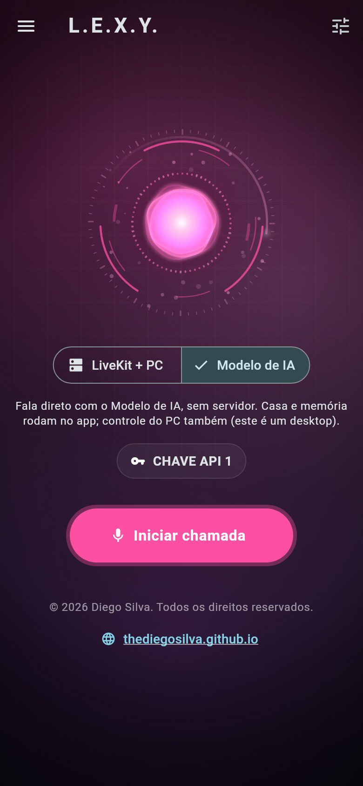
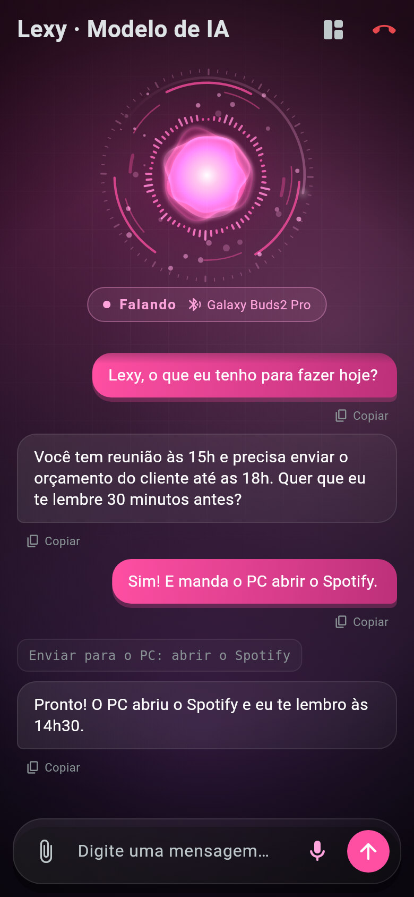
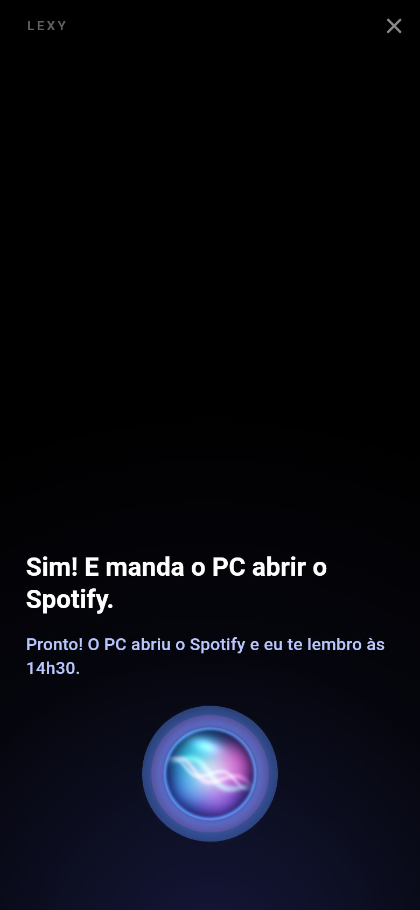
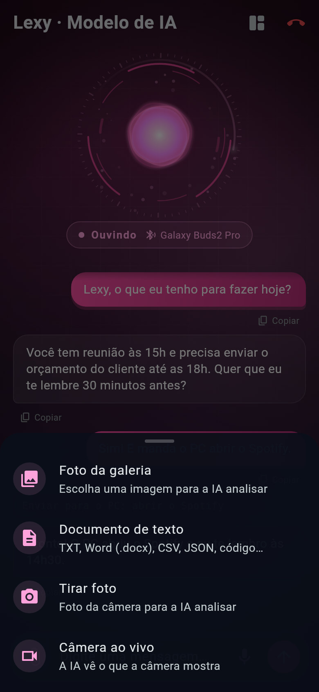
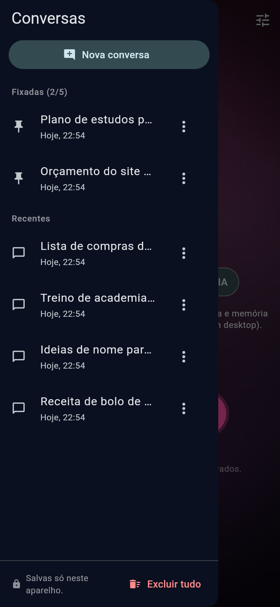
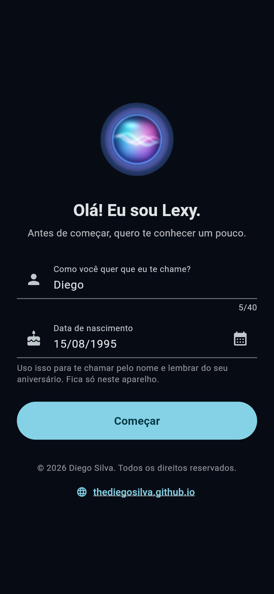
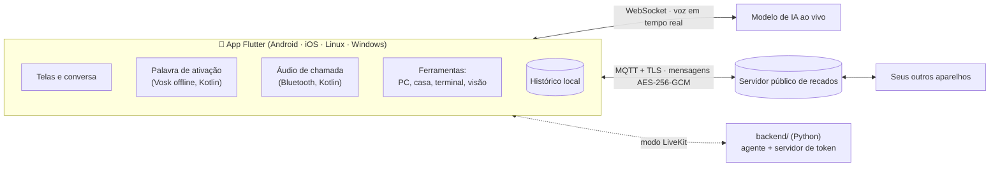

<div align="center">


# DiegoVoiceCloud

**Assistente pessoal de voz com IA, multiplataforma.**<br/>
Converse por voz em tempo real, acorde pelo nome com a tela apagada, mostre a câmera, envie fotos e documentos e conecte seus aparelhos com criptografia de ponta a ponta.


</div>

---

## 📱 Telas

<table>
  <tr>
    <td align="center"><br/><sub><b>Início</b></sub></td>
    <td align="center"><br/><sub><b>Conversa por voz</b></sub></td>
    <td align="center"><br/><sub><b>Modo assistente (tela apagada)</b></sub></td>
  </tr>
  <tr>
    <td align="center"><br/><sub><b>Anexos: galeria, documentos, câmera</b></sub></td>
    <td align="center"><br/><sub><b>Histórico (só no aparelho)</b></sub></td>
    <td align="center"><br/><sub><b>Boas-vindas</b></sub></td>
  </tr>
</table>

## ✨ Recursos

| | |
|---|---|
| 🎙️ **Voz em tempo real** | Conversa natural com interrupção, cancelamento de eco e respostas em ~0,5 s. |
| 🌙 **Acorda pelo nome** | No Android, diga **"Lexy"** ou **"Diego"** com a tela apagada: reconhecimento **offline** (Vosk), sem enviar áudio até você chamar. No iPhone, pela Siri. |
| 👩‍🦰👨 **Nome que muda com a voz** | Voz feminina vira **Lexy**, masculina vira **Diego**. Os dois nomes podem ser trocados, e ela chama você pelo seu nome e lembra do seu aniversário. |
| 🎧 **Fone Bluetooth de verdade** | Áudio roteado como chamada: som **e microfone** do fone, troca automática se o fone conectar ou desconectar. |
| 📷 **Visão** | Câmera ao vivo, **foto** para análise, **imagens da galeria** e **documentos** (TXT, Word, CSV, JSON, código). |
| 🔐 **Rede entre aparelhos** | iPhone, Android e PC conversam entre si em redes diferentes, cifrados com **AES-256-GCM** a partir de um código secreto só seu. |
| 🖥️ **Controle do PC** | Abre programas, organiza arquivos, ajusta volume e brilho, usa o terminal e até mouse e teclado, sempre com confirmação para ações perigosas. |
| 💬 **Histórico** | Lateral estilo ChatGPT: fixar (até 5), renomear, excluir e continuar conversas. **Salvo só no aparelho**. |
| 🏠 **Casa e memória** | Integração com Voice Monkey (Alexa) e memória de longo prazo opcional (Mem0). |

## 🧭 Arquitetura



| Camada | Tecnologias |
|---|---|
| App | Flutter 3.50, Dart 3.14, Material 3 |
| Nativo Android | Kotlin: serviço em primeiro plano, Vosk + JNA, AudioTrack/rota de chamada |
| Nativo iOS | Swift: App Intents (atalho da Siri) |
| IA | API de voz ao vivo (WebSocket), agente com chamadas de função |
| Rede entre aparelhos | MQTT com TLS, PBKDF2 + AES-256-GCM |
| Backend opcional | Python, LiveKit Agents, aiohttp |

## 🚀 Como rodar

```bash
cd app
flutter pub get
flutter run                 # com o celular conectado, ou: -d linux / -d windows
```

Na primeira abertura, o app pergunta como você quer ser chamado e a sua data de nascimento.
Depois, em **Configurações → Chaves da API**, adicione a sua chave (gratuita em
[aistudio.google.com/apikey](https://aistudio.google.com/apikey)).

**APK para Android:**

```bash
flutter build apk --release --split-per-abi   # gera app-arm64-v8a-release.apk
```

O modo **LiveKit + PC** (agente rodando no computador) e todos os detalhes de cada recurso estão no
**[Guia completo](docs/GUIA.md)**.

## 🗂️ Estrutura

```
app/
├── lib/
│   ├── main.dart              # início, boas-vindas, serviços do app
│   ├── config/                # configurações e personalidade da IA
│   ├── services/              # voz, áudio, visão, histórico, rede entre aparelhos, ferramentas
│   └── ui/                    # telas: conversa, assistente, histórico, configurações
├── android/…/kotlin/          # palavra de ativação, áudio Bluetooth, serviço em segundo plano
├── ios/Runner/                # atalho da Siri
└── test/                      # 29 testes + gerador das capturas de tela
backend/                       # agente Python (modo LiveKit) e servidor de token
docs/                          # guia completo e capturas
```

## 🔒 Privacidade e segurança

- **Histórico, nome e data de nascimento ficam só no aparelho.** Nada é salvo em servidor.
- A escuta do nome é **offline**: nenhum áudio sai do celular até você chamar.
- A rede entre aparelhos é **cifrada de ponta a ponta**: o servidor de recados só vê bytes embaralhados.
- Ações destrutivas (apagar, desligar, comandos perigosos) **sempre pedem confirmação**.

## 🧪 Testes

```bash
cd app
flutter test                                  # 29 testes
GERAR_CAPTURAS=1 flutter test test/screenshots/   # regenera as capturas do README
```

## 👤 Autor

**Diego Silva**, desenvolvedor full-stack.<br/>
🌐 [thediegosilva.github.io](https://thediegosilva.github.io) · 💼 [LinkedIn](https://www.linkedin.com/in/thediegosilva) · 🐙 [GitHub](https://github.com/thediegosilva)

---

<div align="center">
<sub>© 2026 Diego Silva. Todos os direitos reservados. Veja <a href="LICENSE">LICENSE</a>.</sub>
</div>
